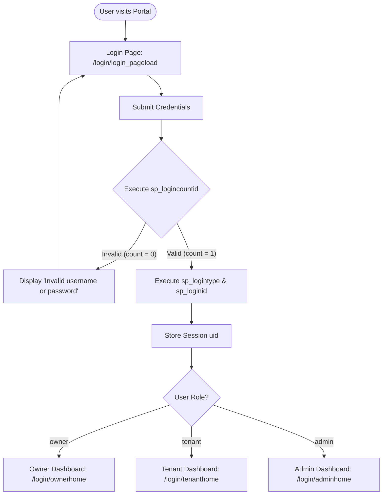
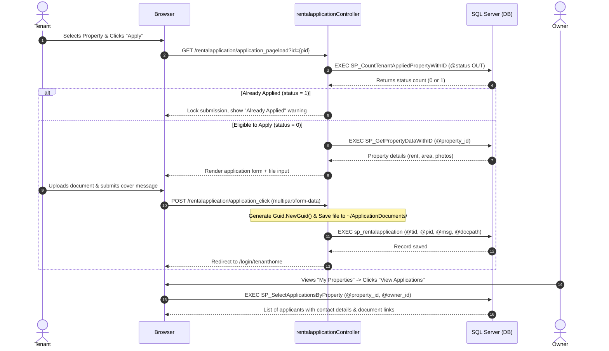

# Property Rental Management System

A full-stack web application built with **ASP.NET MVC 5**, **C#**, **Entity Framework 6**, and **Microsoft SQL Server**. The platform streamlines rental operations by connecting property owners and prospective tenants through role-based workflows, dynamic search filtering, and an end-to-end rental application tracking system.

---

## Table of Contents

- [Overview](#overview)
- [Key Features](#key-features)
  - [Tenant Module](#tenant-module)
  - [Owner (Landlord) Module](#owner-landlord-module)
  - [Admin Module](#admin-module)
  - [Authentication & Validation](#authentication--validation)
- [Tech Stack](#tech-stack)
- [System Architecture](#system-architecture)
- [System Workflows](#system-workflows)
  - [Role-Based Authentication & Routing](#1-role-based-authentication--routing-flow)
  - [Tenant Application Lifecycle](#2-tenant-search--rental-application-lifecycle)
- [Database Design & Setup Scripts](#database-design--setup-scripts)
  - [Table Schemas](#table-schemas)
  - [Stored Procedures](#key-stored-procedures)
- [Route & Endpoint Mapping](#route--endpoint-mapping)
- [Data Validation & Business Rules](#data-validation--business-rules)
- [Security Considerations](#security-considerations)
- [Project Structure](#project-structure)
- [Getting Started](#getting-started)
  - [Prerequisites](#prerequisites)
  - [Database Setup](#database-setup)
  - [Configuration](#configuration)
  - [Running the Application](#running-the-application)
- [Roadmap & Future Enhancements](#roadmap--future-enhancements)

---

## Overview

The **Property Rental Management System** is designed to replace manual, fragmented rental listing and inquiry procedures with a centralized web portal. It features dedicated portals for **Tenants**, **Property Owners**, and **Administrators**, ensuring secure data segregation and tailored functionality for each user role.

---

## Key Features

### Tenant Module
- **Browse Listings:** View all actively listed properties with high-resolution photos, rental rates, floor area, bedroom/bathroom configurations, and lease terms.
- **Dynamic Multi-Criteria Search:** Filter listings dynamically in real time based on location keywords, required bedroom count, and maximum rent budget.
- **Online Rental Application:** Submit applications for listed properties with cover messages and supporting verification documents (e.g., ID proof, income verification).
- **Duplicate Application Prevention:** Backend checks verify prior submissions per property to prevent redundant applications.

### Owner (Landlord) Module
- **Property Listing Management:** Add new rental listings with comprehensive property metadata and multi-image uploads.
- **Listing Portfolio Dashboard:** Monitor all properties owned by the logged-in user in a centralized view.
- **Applicant Review Pipeline:** Review incoming tenant applications per property, inspect applicant profiles (contact info, address, occupation), and view uploaded documents via direct links.

### Admin Module
- **Platform Governance:** Administrative account setup and system oversight access.

### Authentication & Validation
- **Multi-Role Authentication:** Centralized login routing users to their respective dashboards (`Owner`, `Tenant`, `Admin`) based on database-stored credentials and roles.
- **Robust Model Validation:** Strict client- and server-side data validation using ASP.NET Data Annotations (email validation, regex phone number verification, age ranges, and password confirmation).
- **Session Management:** Secure session tracking (`Session["uid"]`) ensuring authorized access to role-specific endpoints.

---

## Tech Stack

| Layer | Technology |
|---|---|
| **Framework** | ASP.NET MVC 5 (.NET Framework 4.7.2) |
| **Language** | C# |
| **Data Access** | Entity Framework 6 (Database-First / EDMX) & ADO.NET (`SqlCommand`, `SqlDataReader`) |
| **Database** | Microsoft SQL Server (Transact-SQL Stored Procedures) |
| **Frontend** | Razor View Engine (`.cshtml`), HTML5, CSS3, Bootstrap 3.4.1 |
| **Client Scripts** | jQuery 3.4.1, jQuery Validation & Unobtrusive Validation |
| **Optimization** | Microsoft.AspNet.Web.Optimization (BundleConfig, WebGrease) |

---

## System Architecture

The application adopts a **Model-View-Controller (MVC)** architectural pattern combined with a hybrid data-access approach:

- **Controllers:** Handle user requests, enforce session checks, manage file storage pipelines, and route data between views and models.
- **Entity Framework & ADO.NET:** Entity Framework handles object mapping and standard stored procedure calls, while raw ADO.NET connections handle dynamic SQL queries and direct data streaming via `SqlDataReader`.
- **Dynamic Stored Procedures:** Search filtering queries are dynamically assembled based on user input and executed through SQL Server stored procedures for performance and security.
- **File Upload Pipeline:** Uploaded images and verification documents are saved to dedicated server directories (`~/phs` and `~/ApplicationDocuments`) with `Guid`-based unique naming to avoid file collisions.

---

## System Workflows

### 1. Role-Based Authentication & Routing Flow



### 2. Tenant Search & Rental Application Lifecycle



---

## Database Design & Setup Scripts

### Table Schemas

```sql
CREATE DATABASE mvc_project;
GO

USE mvc_project;
GO

-- 1. Table: login
CREATE TABLE [dbo].[login] (
    [logid]    INT IDENTITY(1,1) PRIMARY KEY,
    [regid]    INT NULL,
    [username] VARCHAR(50) NOT NULL,
    [pwd]      VARCHAR(50) NOT NULL,
    [usertype] VARCHAR(20) NOT NULL
);
GO

-- 2. Table: admin
CREATE TABLE [dbo].[admin] (
    [ad_id]    INT PRIMARY KEY,
    [ad_name]  VARCHAR(50) NOT NULL,
    [ad_email] VARCHAR(50) NOT NULL
);
GO

-- 3. Table: owner
CREATE TABLE [dbo].[owner] (
    [owner_id]    INT PRIMARY KEY,
    [own_name]    VARCHAR(50) NOT NULL,
    [own_email]   VARCHAR(50) NOT NULL,
    [own_address] VARCHAR(250) NULL,
    [own_phone]   VARCHAR(20) NULL,
    [own_status]  VARCHAR(20) NULL
);
GO

-- 4. Table: tenant
CREATE TABLE [dbo].[tenant] (
    [t_id]         INT PRIMARY KEY,
    [t_name]       VARCHAR(50) NOT NULL,
    [t_age]        INT NULL,
    [t_email]      VARCHAR(50) NOT NULL,
    [t_phone]      VARCHAR(20) NULL,
    [t_address]    VARCHAR(250) NULL,
    [t_occupation] VARCHAR(50) NULL
);
GO

-- 5. Table: property
CREATE TABLE [dbo].[property] (
    [property_id]     INT IDENTITY(1,1) PRIMARY KEY,
    [owner_id]        INT NULL,
    [property_title]  VARCHAR(150) NOT NULL,
    [description]     VARCHAR(500) NULL,
    [location]        VARCHAR(150) NULL,
    [rent]            DECIMAL(10,2) NULL,
    [bedrooms]        INT NULL,
    [bathrooms]       INT NULL,
    [area]            INT NULL,
    [photo1]          VARCHAR(200) NULL,
    [photo2]          VARCHAR(200) NULL,
    [available_from]  DATE NULL,
    [lease_duration]  VARCHAR(50) NULL,
    [property_status] VARCHAR(30) NULL DEFAULT 'Available'
);
GO

-- 6. Table: rental_application
CREATE TABLE [dbo].[rental_application] (
    [app_id]           INT IDENTITY(1,1) PRIMARY KEY,
    [tenant_id]        INT NULL,
    [property_id]      INT NULL,
    [application_date] DATE NULL DEFAULT GETDATE(),
    [ap_message]       VARCHAR(500) NULL,
    [document]         VARCHAR(400) NULL,
    [app_status]       INT NULL DEFAULT 0
);
GO
```

### Key Stored Procedures

```sql
-- Dynamic Property Search Procedure
CREATE PROCEDURE [dbo].[sp_rentalsearch]
    @qry VARCHAR(MAX)
AS
BEGIN
    SET NOCOUNT ON;
    DECLARE @sql NVARCHAR(MAX);
    SET @sql = 'SELECT * FROM property WHERE 1=1 ' + ISNULL(@qry, '');
    EXEC sp_executesql @sql;
END;
GO

-- Duplicate Application Check Procedure
CREATE PROCEDURE [dbo].[SP_CountTenantAppliedPropertyWithID]
    @tenant_id   INT,
    @property_id INT,
    @status      INT OUTPUT
AS
BEGIN
    SET NOCOUNT ON;
    IF EXISTS (
        SELECT 1 FROM rental_application 
        WHERE tenant_id = @tenant_id AND property_id = @property_id
    )
        SET @status = 1;
    ELSE
        SET @status = 0;
END;
GO

-- Property Applications Lookup with Tenant Profiles
CREATE PROCEDURE [dbo].[SP_SelectApplicationsByProperty]
    @property_id INT,
    @owner_id    INT
AS
BEGIN
    SET NOCOUNT ON;
    SELECT 
        ra.app_id,
        ra.tenant_id,
        t.t_name AS tenant_name,
        t.t_email AS email,
        t.t_phone AS phone,
        t.t_address AS address,
        t.t_occupation AS occupation,
        p.property_id,
        p.property_title,
        ra.application_date,
        ra.ap_message,
        ra.document,
        ra.app_status
    FROM rental_application ra
    INNER JOIN tenant t ON ra.tenant_id = t.t_id
    INNER JOIN property p ON ra.property_id = p.property_id
    WHERE ra.property_id = @property_id AND p.owner_id = @owner_id;
END;
GO
```

---

## Route & Endpoint Mapping

| Controller | Action Method | HTTP Verb | Route / URL | Access Level | Description |
|---|---|---|---|---|---|
| `login` | `login_pageload` | GET | `/login/login_pageload` | Public | Displays login view |
| `login` | `login_click` | POST | `/login/login_click` | Public | Authenticates credentials and routes by role |
| `login` | `ownerhome` | GET | `/login/ownerhome` | Owner | Displays owner's properties |
| `login` | `tenanthome` | GET | `/login/tenanthome` | Tenant | Displays all rental listings |
| `login` | `adminhome` | GET | `/login/adminhome` | Admin | Admin landing dashboard |
| `ownerreg` | `ownerreg_pageload` | GET | `/ownerreg/ownerreg_pageload` | Public | Owner registration form |
| `ownerreg` | `ownerreg_click` | POST | `/ownerreg/ownerreg_click` | Public | Creates owner and login records |
| `tenantreg` | `tenantreg_pageload`| GET | `/tenantreg/tenantreg_pageload` | Public | Tenant registration form |
| `tenantreg` | `tenantreg_click` | POST | `/tenantreg/tenantreg_click` | Public | Creates tenant and login records |
| `admininsert`| `insertadmin_pageload`| GET | `/admininsert/insertadmin_pageload` | Public | Admin setup form |
| `admininsert`| `insertadmin_click` | POST | `/admininsert/insertadmin_click` | Public | Creates admin and login records |
| `property` | `property_pageload` | GET | `/property/property_pageload` | Owner | Listing creation form |
| `property` | `property_click` | POST | `/property/property_click` | Owner | Handles multi-image upload & inserts listing |
| `searchrental`| `search_click` | POST | `/searchrental/search_click` | Tenant | Executes dynamic property filter |
| `rentalapplication`| `application_pageload`| GET | `/rentalapplication/application_pageload/{id}` | Tenant | Shows listing details & application form |
| `rentalapplication`| `application_click` | POST | `/rentalapplication/application_click` | Tenant | Uploads supporting document & submits application |
| `ownerapplication`| `applicationlist_pageload`| GET | `/ownerapplication/applicationlist_pageload/{id}` | Owner | Lists applicants and documents for a property |

---

## Data Validation & Business Rules

All models use **System.ComponentModel.DataAnnotations** combined with jQuery Unobtrusive Validation to enforce data integrity:

| Field | Validation Type | Constraint / Rule | Error Message |
|---|---|---|---|
| **Phone Number** | Regex Pattern | `^\d{10}$` (exact 10 digits) | *"enter valid number"* |
| **Email Address** | Built-in Attribute | `[EmailAddress]` format check | *"enter valid email id"* |
| **Age** | Range Boundary | `[Range(18, 100)]` (Adults only) | *"enter valid age"* |
| **Confirm Password**| Comparison Check | `[Compare("pass")]` | *"Password mismatch"* |
| **Property Rent/Area**| Numeric Boundaries | Non-negative decimals and integers | *"Enter rent"*, *"Enter area"* |
| **Document Upload**| Collision Prevention| `Guid.NewGuid().ToString() + extension` | Avoids duplicate filenames on disk |
| **Rental Application**| Duplication Guard | Single application per `(tenant_id, property_id)` | *"You have already applied for this property."* |

---

## Security Considerations

1. **Session-Level Access Guards:** Controllers check `Session["uid"] == null` and redirect unauthorized or expired requests directly to the login portal.
2. **File Storage Isolation:** User uploads are isolated into specific subdirectories (`~/ApplicationDocuments/` and `~/phs/`) with GUID-based naming conventions, preventing directory traversal and accidental file overwrites.
3. **Encapsulated Data Transactions:** All insert, update, and complex query operations execute through Transact-SQL stored procedures, separating database execution logic from application code.

---

## Project Structure

```text
mvc_project/
│
├── App_Start/
│   ├── BundleConfig.cs          # Script and style bundling configuration
│   ├── FilterConfig.cs          # Global MVC action filters
│   └── RouteConfig.cs           # Default routing rules
│
├── Controllers/
│   ├── loginController.cs               # Authentication, redirection, and home views
│   ├── ownerregController.cs            # Landlord registration
│   ├── tenantregController.cs           # Tenant registration
│   ├── admininsertController.cs         # Admin registration
│   ├── propertyController.cs            # Property creation & media upload
│   ├── searchrentalController.cs        # Dynamic property search logic
│   ├── rentalapplicationController.cs   # Tenant application submission & document upload
│   └── ownerapplicationController.cs    # Landlord application review
│
├── Models/
│   ├── logincls.cs              # Login view model with validation
│   ├── ownerregcls.cs           # Owner registration view model
│   ├── tenantregcls.cs          # Tenant registration view model
│   ├── admininsertcls.cs        # Admin registration view model
│   ├── propertycls.cs           # Property listing view model
│   ├── searchpropertycls.cs     # Search filter view model
│   ├── rentalapplicationcls.cs  # Rental application view model
│   └── ownerapplicationcls.cs   # Owner application review view model
│
├── Views/
│   ├── Home/                    # Landing, About, and Contact views
│   ├── login/                   # Login and role-specific home dashboards
│   ├── ownerreg/                # Landlord registration view
│   ├── tenantreg/               # Tenant registration view
│   ├── admininsert/             # Admin creation view
│   ├── property/                # Property listing creation view
│   ├── rentalapplication/       # Tenant application submission form
│   ├── ownerapplication/        # Owner applicant review table
│   └── Shared/
│       ├── _Layout.cshtml       # Master layout with responsive navbar
│       └── Error.cshtml         # Global error view
│
├── ApplicationDocuments/        # Uploaded tenant verification documents (GUID-named)
├── phs/                         # Uploaded property images
├── Model1.edmx                  # Entity Framework database model
├── Web.config                   # App settings and database connection strings
└── packages.config              # NuGet package dependencies
```

---

## Getting Started

### Prerequisites
- **Visual Studio 2019** or **Visual Studio 2022** (with the *ASP.NET and web development* workload installed)
- **.NET Framework 4.7.2** Developer Pack
- **Microsoft SQL Server** (2016 or newer / SQL Server Express)
- **SQL Server Management Studio (SSMS)**

### Database Setup
1. Open SQL Server Management Studio and create a database named `mvc_project`.
2. Execute the database schema scripts and stored procedure definitions provided in the [Database Design & Setup Scripts](#database-design--setup-scripts) section.

### Configuration
Update the connection strings in `mvc_project/Web.config` to match your local SQL Server instance:

```xml
<connectionStrings>
  <!-- Entity Framework Connection String -->
  <add name="mvc_projectEntities" 
       connectionString="metadata=res://*/Model1.csdl|res://*/Model1.ssdl|res://*/Model1.msl;provider=System.Data.SqlClient;provider connection string=&quot;data source=YOUR_SERVER_NAME;initial catalog=mvc_project;integrated security=True;MultipleActiveResultSets=True;App=EntityFramework&quot;" 
       providerName="System.Data.EntityClient" />

  <!-- ADO.NET Connection String for Stored Procedures -->
  <add name="importdataconnection" 
       connectionString="server=YOUR_SERVER_NAME;database=mvc_project;Integrated Security=True;" />
</connectionStrings>
```

### Running the Application
1. Clone the repository:
   ```bash
   git clone https://github.com/your-username/property-rental-management.git
   ```
2. Open `mvc_project.sln` in Visual Studio.
3. Right-click the solution in Solution Explorer and select **Restore NuGet Packages**.
4. Press `Ctrl + Shift + B` to build the solution.
5. Press `F5` or click **IIS Express** to run the project in your browser.

---

## Roadmap & Future Enhancements

- [ ] **Role-Based Action Filters (`[AuthorizeRole]`):** Transition from manual session checks to custom ASP.NET MVC authorization action filter attributes.
- [ ] **Application State Machine:** Add buttons for owners to mark applications as `Approved`, `Rejected`, or `Under Review`.
- [ ] **In-App & Email Notifications:** Send automated email alerts using SendGrid/SMTP when a
